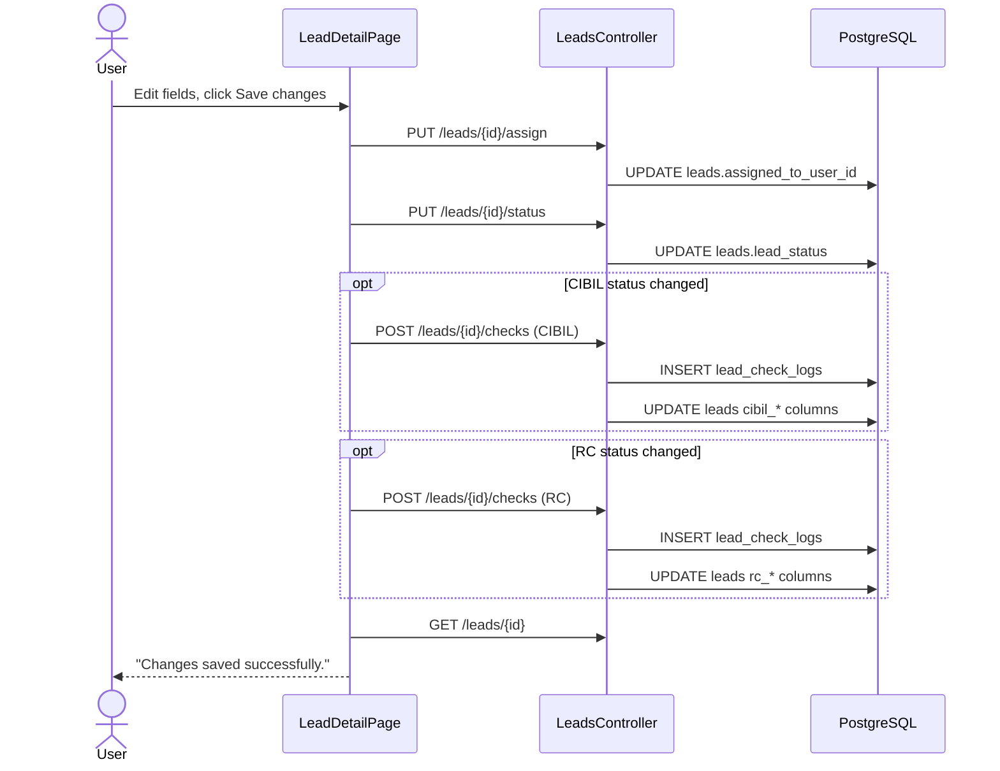
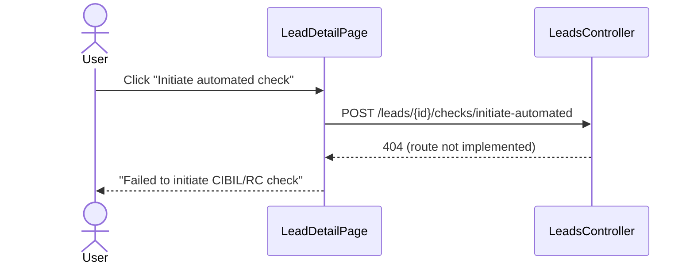

# Lead Verification Checks: CIBIL and RC

This document describes how the **CIBIL Check** and **RC Check** on a lead work today: what **Initiate Automated Check** does, how manual updates are saved, and where the data is stored.

Where something is described as intended behaviour, it comes from the specs and is marked as such. Everything else was verified against the code. Source files are given in backticks.

Related docs: `Leads_Module_Enhancements.md` (feature requests), `Leads_Edit_Redesign.md` (page layout).

---

## 1. Overview and glossary

| Term | Meaning in this feature |
|---|---|
| **CIBIL check** | Credit bureau check on the applicant. Stored as a status, plus an optional score. |
| **RC check** | Verification of the vehicle's Registration Certificate at lead stage. Stored as a status only. |
| **Check status** | One of `NOT_STARTED`, `IN_PROGRESS`, `PASSED`, `FAILED` (`CheckStatuses` in `Domain/ValueObjects/LeadConstants.cs`). |
| **Lead status** | The lifecycle stage of the lead: `NEW`, `IN_PROGRESS`, `QUALIFIED`, `CONVERTED`, `REJECTED` (`LeadStatuses`). Separate from the checks. |
| **Automated check** | A check run by an external service (CIBIL bureau, Vahan). **Not implemented yet.** See section 5. |
| **RC tracker** | A different feature: post-disbursal RC tracking per **loan** (`rc_pipeline_tracker`). Not related to the lead RC check. See section 3.4. |

---

## 2. Where it lives and who can use it

- **Page:** Lead detail, `rclimit-ui/src/pages/leads/LeadDetailPage.tsx`.
  - Status tiles at the top show the current CIBIL, RC and lead status.
  - The **CIBIL verification** and **RC verification** cards on the right hold the status, score (CIBIL only), remarks and the **Initiate automated check** button.
  - The footer **Save changes** button saves assignment, lead status and check changes together.
- **Permission:** `leads.edit`. Enforced in the API on every write (`[HasRight("leads.edit")]` in `LeadsController.cs`) and in the UI (`canEdit`).
- **Locked leads:** a lead is locked once converted (`ConvertedCustomerId` set or status `CONVERTED`). Its fields are disabled in the UI, and the API rejects check and status changes with `422`.

---

## 3. Data model

### 3.1 Current state (on the lead)

| Column (`leads`) | Holds | Default |
|---|---|---|
| `cibil_check_status` | Latest CIBIL status | `NOT_STARTED` |
| `cibil_checked_at` | When the CIBIL status was last recorded | null |
| `cibil_score_preview` | Latest CIBIL score | null |
| `rc_check_status` | Latest RC status | `NOT_STARTED` |
| `rc_checked_at` | When the RC status was last recorded | null |
| `vahan_validation_status` | Intended Vahan result | `PENDING` (**never written by any code**) |
| `lead_status` | Lifecycle status | `NEW` |
| `assigned_to_user_id` | Assignee | null |

Only the latest value is kept here. Previous values are not recoverable from the lead.

### 3.2 History (`lead_check_logs`)

Created in migration `018_leads_enhancements.sql`. One row per recorded check. The table is append-only in code: nothing updates or deletes a row.

| Column | Type | Notes |
|---|---|---|
| `log_id` | UUID PK | |
| `tenant_id` | UUID | |
| `lead_id` | UUID FK -> leads | cascade delete |
| `check_type` | VARCHAR(20) | `CIBIL` or `RC` (`CheckTypes`) |
| `status` | VARCHAR(20) | status recorded |
| `score` | INT, nullable | CIBIL score, if given |
| `remarks` | TEXT, nullable | **the only place remarks are stored** |
| `source` | VARCHAR(20) | default `MANUAL`. Only `MANUAL` is written today. `VAHAN` and `CIBIL_API` are defined but unused. |
| `performed_by_user_id` | UUID FK -> auth.users | who recorded it |
| `created_at` | TIMESTAMPTZ | when |

### 3.3 Vahan validation

`leads.vahan_validation_status` and the `VAHAN` source value exist, but no handler sets either. The Vahan result is not used anywhere yet.

### 3.4 Related tables that this feature does **not** use

These two tables were asked about. Neither is written or read by the lead CIBIL/RC check.

**`verification_logs`** (migration `011_public_rc_tracker.sql`, entity `VerificationLog`)
- Columns: `verification_id`, `tenant_id`, `vehicle_id`, `customer_id`, `verification_type`, `request_payload` and `response_payload` (JSONB), `result_status`, `executed_at`.
- Spec intent (`RC_Limit_System_Specification.md`, section 6): keep the raw payloads of automated CIBIL pulls and Vahan lookups for audit. Types: `CIBIL_PULL`, `VAHAN_RC_LOOKUP`, `CHALLAN_CHECK`.
- **Today:** the table and entity exist, but no code inserts or queries it.
- It is keyed by vehicle and customer, not by lead. When automated checks are built, decide whether they write here and link to the lead, or use `lead_check_logs`.

**`rc_pipeline_tracker`** (migration `011_public_rc_tracker.sql`, entity `RcPipelineTracker`)
- A different feature: post-disbursal RC tracking for a **loan**. Columns: `current_stage` (default `DISBURSED_PENDING_RTO`), `aging_status` (default `ON_TIME`), RTO acknowledgement and final RC document URLs, and their timestamps.
- One row is created by `CreateLoanCommand` when a loan is created. It is read by the loan detail query and the dashboard pending-RC count (`GetDashboardSummaryQuery`, stage not `BANK_VERIFIED_CLEARED`).
- **Nothing updates** the stage, aging status or document fields.
- The dashboard RC aging alerts (`GetRcAgingAlertsQuery`) do not read this table. They compute aging from the loan's disbursal date: 30 days or fewer is `ON_TIME`, 31 to 44 is `WARNING_ZONE`, and 45 or more is `OVERDUE_LOCK`. Only loans over 15 days old in `DISBURSED_RC_PENDING` are listed.

---

## 4. Flow A: manual update and Save (works today)

### 4.1 What the user does

1. Changes the assignee, lead status, CIBIL status / score / remarks, or RC status / remarks.
2. Clicks **Save changes** in the footer.

### 4.2 What the UI sends

`handleSaveChanges` in `LeadDetailPage.tsx` sends requests one after another:

| Step | Request | Sent when | Handler |
|---|---|---|---|
| 1 | `PUT /api/v1/leads/{id}/assign` `{ assigneeUserId }` | **Always** (empty becomes null) | `AssignLeadCommand` |
| 2 | `PUT /api/v1/leads/{id}/status` `{ status }` | **Always**, even if unchanged | `UpdateLeadStatusCommand` |
| 3 | `POST /api/v1/leads/{id}/checks` `{ checkType: "CIBIL", status, score, remarks }` | Only if the CIBIL status differs from the stored status | `RecordLeadCheckCommand` |
| 4 | `POST /api/v1/leads/{id}/checks` `{ checkType: "RC", status, remarks }` | Only if the RC status differs from the stored status | `RecordLeadCheckCommand` |

After the last step the page refetches the lead and shows an alert, **"Changes saved successfully."**

### 4.3 What the server does

`UpdateLeadStatusCommand` rejects:
- setting status to `CONVERTED` (use conversion instead), and
- changing the status of an already converted lead.

`RecordLeadCheckCommand` (`Application/Leads/RecordLeadCheckCommand.cs`) does the following in **one** `SaveChanges`:
1. Inserts a `lead_check_logs` row with `source = MANUAL`, `performed_by_user_id` set to the caller, and `created_at` set to now.
2. Overwrites the current state on the lead:
   - **CIBIL:** `cibil_check_status`, `cibil_checked_at`, and `cibil_score_preview` if a score was sent.
   - **RC:** `rc_check_status`, `rc_checked_at`.

It rejects checks on converted leads (`422`).

### 4.4 Diagram

### 4.5 Rules to know

- **Score or remarks alone do not save.** If the CIBIL status is unchanged, the POST is not sent, so a score or remark typed without changing the status is silently dropped.
- **RC score is not sent.** The RC form has no score field. The RC request sends remarks only.
- **Not atomic.** The steps are separate requests. If one fails, earlier steps stay saved, and the user sees only a generic "Failed to save changes" alert.
- **Remarks are not prefilled.** The page never loads check history (section 6), so the remark boxes always start empty, even when earlier remarks exist.

---

## 5. Flow B: Initiate Automated Check

### 5.1 What happens today

Clicking **Initiate automated check** on either card does this:

1. The UI sets the card's busy state and sends `POST /api/v1/leads/{id}/checks/initiate-automated` with `{ checkType: "CIBIL" }` or `{ checkType: "RC" }`.
2. **That endpoint does not exist.** `LeadsController` has no route for it, and the string appears nowhere in the backend. The server returns `404`.
3. The UI shows the alert **"Failed to initiate CIBIL/RC check. Please try again."**
4. Nothing is saved, and no log row is written.

### 5.2 What exists in the code, and what does not

| Item | Status |
|---|---|
| `initiate-automated` route | **Missing** |
| CIBIL service interface | **Missing** (no interface, no stub) |
| `IVahanService` + `NoOpVahanService` | Exists and is registered in `WebApi/Program.cs`. Returns a fixed fake vehicle record. **Never called.** |
| `CheckSources.VahanApi` (`VAHAN`), `CheckSources.CibilApi` (`CIBIL_API`) | Constants exist. **Unused.** |
| `tenant_settings.custom_vahan_api_key` | Column exists. **Unused.** |
| `verification_logs` table | Exists. **Unused.** (section 3.4) |
| Background processing | **None.** The UI expects a background job, and after 2 seconds it refetches. Nothing is queued or run. |

### 5.3 Intended design (from the UI and specs)

Intended design, not built yet:
- The UI expects the call to start a background job for the given check type. The specs (`RC_Limit_System_Specification.md`, `rclimit_master_system_requirements_specification_v3_0.md`) describe an automated CIBIL bureau pull and a Vahan RC lookup. The Vahan lookup covers blacklist, tax and existing hypothecation.
- Expected result: the job updates the lead's check status and score, writes a history row with `source` set to `CIBIL_API` or `VAHAN`, and keeps the raw response for audit.

Decisions still open before building it:
- Whether the raw response goes to `verification_logs` (keyed by vehicle and customer) or only to `lead_check_logs`.
- Whether an automated result can overwrite a manual one, and how a conflict is shown.
- Whether `vahan_validation_status` is set from the Vahan result.

---

## 6. Downstream effects

- **Conversion copies the score.** `ConvertLeadToCustomerCommand` copies `cibil_score_preview` to `customers.cibil_score`. It derives the tier: 750 or more is `GREEN`, 650 or more is `AMBER`, below that is `RED`. (The tier is stored on the customer, not on the lead.)
- **Checks do not gate conversion.** A lead can be converted with CIBIL or RC still `NOT_STARTED`, `FAILED` or anything else.
- **Checks do not change lead status.** Recording a PASSED or FAILED check does not move the lead to `QUALIFIED` or `REJECTED`. That is manual.

---

## 7. API reference

All routes are under `/api/v1/leads`. All require authentication.

| Method and path | Right | Purpose | Response |
|---|---|---|---|
| `GET /{id}` | authenticated | Lead detail, including `checkHistory` (newest first) | `200` with the lead |
| `PUT /{id}/assign` | `leads.edit` | Set or clear the assignee | `200` |
| `PUT /{id}/status` | `leads.edit` | Set lead status | `200` |
| `POST /{id}/checks` | `leads.edit` | Record a CIBIL or RC check (history and current state) | `200` |
| `POST /{id}/checks/initiate-automated` | `leads.edit` | **Not implemented.** Called by the UI. | `404` |

Error cases on the implemented routes:

| Case | Status | Source |
|---|---|---|
| Lead not found, or belongs to another tenant | `404` | `NotFoundException` |
| Check recorded on a converted lead | `422` | `BusinessRuleException` |
| Status set to `CONVERTED` directly | `422` | `UpdateLeadStatusCommand` |
| Status change on a converted lead | `422` | `UpdateLeadStatusCommand` |
| Missing `leads.edit` right | `403` | `HasRight` attribute |

Note: `checkType`, `status` and `score` are not validated. An unknown check type is saved to the log but changes no current state. A status longer than 20 characters fails at the database.

---

## 8. Known gaps and follow-ups

1. **Automated check is not built.** The button always fails with 404. Either implement the route and integrations, or hide the button until they exist.
2. **Score and remarks alone are not saved.** The UI should send a check whenever the status, score or remarks change.
3. **Save is not atomic.** Wrap the save in one request, or at least report which step failed.
4. **Check history is never loaded in the UI.** `checkHistory` is a constant empty array, so the "Last checked ... by ..." box never shows and remarks are never prefilled. Use the `checkHistory` field the detail API already returns.
5. **Vahan result is never recorded.** `vahan_validation_status` stays `PENDING`.
6. **Input is not validated.** Add checks for `checkType` (`CIBIL` or `RC`), for `status` (the four values), and for score range.
7. **`verification_logs` is unused.** Decide whether automated checks use it (section 5.3), or remove it.
8. **Name collision.** "RC check" (lead stage) and "RC tracker" (loan stage, `rc_pipeline_tracker`) share a name. Consider renaming one in the UI.
